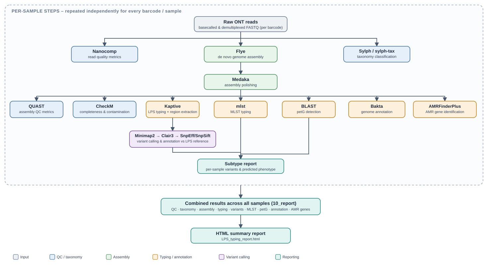

# LPS_typing_ONT
Bioinformatics pipeline for *Pasteurella multocida* LPS typing using Oxford Nanopore sequencing data

## Contents

- [Quick start](#quick-start)
- [Overall pipeline](#overall-pipeline)
- [User guide](#step-by-step-user-guide)
- [Database setup](#database-setup)
- [Example data](#example-data)
- [Optional parameters](#optional-parameters)
- [Output files](#structure-of-the-output-folders)
- [Publication figures](#publication-figures)
- [Advanced use](#advanced-use)
- [Troubleshooting](#troubleshooting)
- [Acknowledgements / citations / credits](#acknowledgements--citations--credits)

---

## Quick start

**Requirements:**
- [Nextflow](https://www.nextflow.io/) ≥ 25.04.6
- [Singularity](https://sylabs.io/singularity/) or [Apptainer](https://apptainer.org/) (the pipeline uses containers for all tools)

**1. Clone the repository**
```bash
git clone https://github.com/julianzaugg/LPS_typing_ONT.git
cd LPS_typing_ONT
```

**2. Obtain databases** — see [Database setup](#database-setup)

**3. Create a samplesheet** — see [User guide](#step-by-step-user-guide)

**4. Run the pipeline**

Local / non-SLURM:
```bash
nextflow run main.nf \
  -profile apptainer \
  --samplesheet /path/to/samples.csv \
  --outdir /path/to/results \
  -resume
```

SLURM cluster:
```bash
nextflow run main.nf \
  -profile apptainer,slurm \
  --samplesheet /path/to/samples.csv \
  --outdir /path/to/results \
  --slurm_account YOUR_ACCOUNT \
  -resume
```

Or edit `nextflow.sh` (set `SAMPLESHEET`, `OUTDIR`, `YOUR_ACCOUNT`, `YOUR_PARTITION`) and submit:
```bash
sbatch nextflow.sh
```

---

## Overall pipeline



### 1. Basecalling

The basecalling and demultiplexing step are performed by the user outside of the pipeline.

### 2. Nanopore reads quality metrics

[Nanocomp](https://github.com/wdecoster/nanocomp) v1.24.2 is used to compute Nanopore read metrics (e.g. Median Read Length, Read N50, Median Read Quality). Those metrics are computed for each barcode on the raw reads included in the basecalled fastq files.

### 3. Flye assembly and polishing

- The Nanopore reads are assembled using the software [Flye](https://github.com/fenderglass/Flye) v2.9.5. By default, Flye will use a reduced coverage for initial disjointig assembly to speed up the assembly (config parameter `flye_args = "--asm-coverage 100"`).
- The draft assemblies are subsequently polished using [Medaka](https://github.com/nanoporetech/medaka) v2.0.1. The model parameter selected to run Medaka (e.g. `r1041_e82_400bps_sup_v5.0.0`) must correspond to the model used for the basecalling (e.g. `dna_r10.4.1_e8.2_400bps_sup.cfg`).

### 4. Assembly quality assessment with QUAST

[QUAST](https://quast.sourceforge.net/quast.html) v5.2.0 is used to compute genome assembly metrics on the polished assemblies.

### 5. Assembly quality assessment with CheckM

[CheckM](https://github.com/Ecogenomics/CheckM) v1.2.2 (command [lineage_wf](https://github.com/Ecogenomics/CheckM/wiki/Workflows#lineage-specific-workflow)) is used to compute genome assembly completeness and contamination, based on the presence or absence of marker genes.

### 6. Sylph taxonomy classification

Nanopore reads are classified with the containment-based taxonomy profiler [Sylph](https://sylph-docs.github.io) v0.8.1, and taxonomic labels are assigned with [sylph-tax](https://github.com/bluenote-1577/sylph-tax) v1.3.0. Both the GTDB R232 and RefSeq Fungi databases are used, downloaded from the [Sylph pre-built databases](https://sylph-docs.github.io/pre%E2%80%90built-databases/).

### 7. LPS typing using Kaptive

The LPS type of the sample is obtained using the software [Kaptive](https://kaptive.readthedocs.io/en/latest/) v3. The genome assemblies are used as input to this tool. The 9 LPS database is used but can be modified (config parameter `kaptive_db_9lps`).

### 8. Variant calling using Clair3

- The reads are mapped to the reference LPS type sequence identified by Kaptive using the sequence alignment program [Minimap2](https://github.com/lh3/minimap2).
- Then [Clair3](https://github.com/HKU-BAL/Clair3/) v1.2.0 is used to call variants in the reads as compared to the reference LPS type sequence. The Clair3 model must be selected to match the ONT platform and basecalling model used (e.g. `r1041_e82_400bps_sup_v500`). The list of Clair3 models is available at https://github.com/nanoporetech/rerio/tree/master/clair3_models.
- Then [SnpEff](https://pcingola.github.io/SnpEff/) v5.3.0a is used to annotate and predict the effects of the variants on genes and proteins (such as amino acid changes).
- Finally, [SnpSift](https://pcingola.github.io/SnpEff/#snpsift) v5.3.0a is used to extract the variants predicted to have a high impact on the protein (frameshift and stop_gained variants).

### 9. MLST typing

[mlst](https://github.com/tseemann/mlst) v2.33.1 scans the genome assemblies against the PubMLST typing scheme `pmultocida_2` by default (RIRDC). The typing scheme can be modified by specifying `--mlst_scheme` (e.g. `--mlst_scheme pmultocida`).

The database bundled inside the mlst container is frozen at the time of the container build. PubMLST now requires a login to download updated alleles and profiles, so the tool's built-in update mechanism no longer works. To use the latest scheme, download files manually and supply them via `--mlst_datadir` (see below).

#### Updating the MLST database

1. Log in to [PubMLST](https://pubmlst.org/organisms/pasteurella-multocida) and navigate to the **pmultocida_2 (RIRDC)** scheme.
2. Download allele sequences for each of the 7 loci (`RIRDC_adk`, `RIRDC_est`, `RIRDC_gdh`, `RIRDC_mdh`, `RIRDC_pgi`, `RIRDC_pmi`, `RIRDC_zwf`). PubMLST provides these as `<locus>.fas` FASTA files.
3. Download the allele profiles as `pmultocida_2.txt`.
4. Place all files in `databases/mlst_db/pmultocida_2/`:
   ```
   databases/mlst_db/pmultocida_2/
     RIRDC_adk.fas
     RIRDC_est.fas
     ...
     pmultocida_2.txt
   ```
5. Run the pipeline with `--mlst_datadir databases/mlst_db`. On first run, the pipeline automatically renames allele files to the `.tfa` extension that mlst expects, and builds the BLAST index. The prepared database is saved to `databases/mlst_db_prepared/`. Use `-resume` on subsequent runs to skip rebuilding.

A pre-downloaded database (2026-08-18) is included at `databases/mlst_db/`.

### 10. petG detection

[BLAST](https://blast.ncbi.nlm.nih.gov/Blast.cgi) v2.17.0 searches the assembly with the X73 *petG* CDS (`petG_X73_NZ_CM001580.fasta`, 1581 bp, in `databases/LPS/`).
Only X73 is used as the reference, so petG-like paralogs are excluded by the identity and length thresholds.
A hit counts as *petG* when it has at least 95% identity, a genomic span greater than 1570 bp, and covers the X73 gene to within 3 bp of both ends.
The best such hit is then checked for function from its BLAST alignment, without translating the gene:

* `nonfunctional`: the net gap length is not a multiple of 3 (frameshift), a substituted codon becomes a stop codon before the X73 stop, or the start codon is lost
* `uncertain`: the reading frame is restored by compensating frameshifts, or there is an in-frame indel
* `functional`: none of the above
* `absent`: no hit passes the thresholds (treated like `nonfunctional` by the phenotype rules)

Hit sequences and the raw BLAST table (with alignment strings) are written to `<sample>/13_petG/`.
The status and the reason (for example `frameshift: net -1 bp (first -1 bp at ref 988)`) are reported in `10_report/10_ONT_petG_status.tsv` and the phenotype report.

### 11. LPS subtype and phenotype reports

The subtype report (`10_ONT_subtype_report.tsv`) lists every Clair3 variant that matches the [LPS subtype database](databases/LPS/LPS_subtype_database_v3.txt) at the same reference sequence, position, reference allele and alternate allele.

The phenotype report (`10_ONT_phenotype_report.tsv`) gives one predicted phenotype per sample.
It is produced by `bin/lps_phenotype.py`, which is shared with the Illumina pipeline, from three inputs:

* `databases/LPS/phenotype_rules.tsv`: the phenotype definitions (the only place phenotypes are defined)
* `databases/LPS/LPS_subtype_database_v3.txt`: the curated subtypes, with an optional curated `EFFECT` per variant
* the sample's variants (Clair3 calls with `FILTER=PASS`), the per-gene read coverage and the petG status

#### Gene states

Each gene named in the rules gets one state, computed from all of the sample's variants inside its CDS (coordinates from the reference GenBank file):

1. `inactivating`: a variant is curated `EFFECT=inactivating`; or snpEff reports `stop_gained` or `start_lost`; or an indel touches the start or stop codon; or the net indel length in the gene is not a multiple of 3 (net frameshift)
2. `uncertain`: the reading frame is intact but altered (an in-frame indel, or frameshifts that cancel out, such as L1-3 + L1-4 in pcgB, net +9 bp); or snpEff reports `stop_lost`; or less than `--phenotype_min_gene_coverage` (default 90%) of the CDS is covered by reads
3. `modifying`: a variant is curated `EFFECT=modifying` (an amino acid change known to change the structure; acts only through a `REQUIRES` rule)
4. `functional`: anything else, including plain substitutions

Variants curated `EFFECT=none` are ignored, which is how an `uncertain` call is resolved as functional once there is evidence.

#### Confidence gate for uncurated calls

Curated variants always count.
An uncurated variant call that is not confident cannot decide a gene state on its own.
A call is low-confidence when its allele fraction is below `--phenotype_min_confident_af` (default 0.9), or when it is an indel of a single base that sits in a reference run of at least `--phenotype_homopolymer_min_run` (default 3) of that base.
Confidence uses the Clair3 allele fraction, and whether the indel changes the length of a homopolymer run of 3 or more bases in the reference (the commonest ONT error).
If leaving the low-confidence calls out changes the gene state, the gene is `uncertain` and the basis names the call, for example `uncertain: hptE depends on a low-confidence call (1bp ins at 5155: AF=0.63, extends a GGG run)`.
The gate can only widen a call to `uncertain`; it never makes a call more definite.
No translation is done, so a stop codon between two compensating frameshifts cannot be seen; this is why such genes are `uncertain` rather than `functional`.
Per-gene coverage comes from `samtools depth -a` on the minimap2 alignment (positions below `--phenotype_min_depth` count as not covered); without it a deleted gene would have no variants and would read as functional.

#### Phenotype rules

`phenotype_rules.tsv` has one row per phenotype with the columns `TYPE`, `STEP`, `GENES`, `PETG`, `REQUIRES` and `PHENOTYPE`:

* `STEP` is the position of the gene(s) in biosynthetic order (1 = the residue closest to the inner core); `full` is the row used when no rule gene is inactivated
* `GENES` lists the interchangeable genes of that step, for example `pcgA,pcgB,pcgC,pcgD`
* `PETG` is `functional`, `nonfunctional` or `any`; `absent` counts as `nonfunctional`
* `REQUIRES` is an optional extra condition such as `gctD:modifying`; rows with a condition are checked before rows without

The phenotype is the rule row of the **lowest inactivated step** whose `PETG` matches the sample.
Uncertain genes (and an uncertain or unassessed petG) are evaluated both ways, and every distinct result is reported, for example `L1_P1 | L1_P3`.
Types without rules (currently L2 and L4 to L9) get no phenotype.
Adding a type, a step or a petG split is a change to `phenotype_rules.tsv` only; the rules file is validated at run time (gene names must be CDS in the type's reference, every type needs a `full` row).

#### Phenotype basis

`PHENOTYPE_BASIS` states how much to trust each call:

* `curated`: every variant that changed a gene state is in the subtype database
* `uncertain: ...`: the call depends on an uncertain gene or petG; the text names the gene, the reason and the phenotype for each alternative
* `uncurated: ...`: a variant that is not in the subtype database changed a gene state (the variants are listed, and `SUBTYPES` includes `novel`); these are candidates for curation
* `mixed call: ...` (suffix): a curated variant that changed a gene state has an allele fraction below 0.9 (Clair3 calls with allele fraction < 0.9)
* `no phenotype rules for type`, `untypeable`

The pipeline also generates a self-contained HTML summary report (`LPS_typing_report.html`) from the combined `10_report` outputs when Kaptive and Clair3 are enabled. See the "Combined HTML report" parameters and the `10_report` entry under the output folders below for details.

### 12. Genome annotation using Bakta

[Bakta](https://github.com/oschwengers/bakta) v1.12.0 annotates the genome assemblies. The default database is v6.0 (2025-02-24), available from [Zenodo record 10.5281/zenodo.14916843](https://zenodo.org/records/14916843).

Bakta is run with `--proteins databases/trusted_bakta_proteins.fasta`, a set of trusted proteins used to prioritise annotations. This file is built with [`bin/bakta_proteins_format.py`](bin/bakta_proteins_format.py), which combines a type-strain GenBank file and/or additional protein FASTA files into the combined FASTA format Bakta expects for `--proteins`:

```bash
python bin/bakta_proteins_format.py type_strain.gbk additional_proteins.fasta -o databases/trusted_bakta_proteins.fasta
```

### 13. Antimicrobial resistance genes

[AMRFinderPlus](https://github.com/ncbi/amr) v4.0.23 identifies AMR genes in the genome assemblies. The tested database version is 2025-03-25.1.

---

## Database setup

The pipeline uses two types of databases:

**Included in this repository** (`databases/` directory):

| Database | Contents | Notes |
|----------|----------|-------|
| LPS references (L1–L9) | `databases/LPS/` — FASTA/GenBank files, `reference_LPS.txt`, `LPS_subtype_database_v3.txt`, `phenotype_rules.tsv`, `phenotype_lookup.tsv`, `petG_X73_NZ_CM001580.fasta` | Required for LPS typing and variant calling |
| Kaptive3 LPS DB | `databases/kaptive3_LPS_db_v1/9lps.gbk`, `9lps.logic` | Required for LPS typing |

**Downloaded separately** — the pipeline can download these automatically on first run (set the corresponding `--skip_download_*_db false`), or you can download them manually and point to them with `--*_db`:

| Database | Required for | Default path | Tested version | Source | Approx. size |
|----------|-------------|-------------|---------------|--------|-------------|
| CheckM | Assembly quality | `<pipeline_dir>/databases/checkm_data_2015_01_16` | `checkm_data_2015_01_16` | [CheckM installation docs](https://github.com/Ecogenomics/CheckM/wiki/Installation) | ~ 1.4 GB |
| Sylph GTDB + Fungi | Taxonomy classification | `<pipeline_dir>/databases/sylph/` | GTDB R232, Fungi RefSeq 2025-10-11 | [Sylph pre-built databases](https://sylph-docs.github.io/pre%E2%80%90built-databases/) | ~ 25 GB |
| Clair3 model | Variant calling | `<pipeline_dir>/databases/clair3_models/r1041_e82_400bps_sup_v500` | `r1041_e82_400bps_sup_v500` | [Rerio models](https://github.com/nanoporetech/rerio/tree/master/clair3_models) — manual download | < 100 MB |
| Bakta | Genome annotation | `<pipeline_dir>/databases/bakta/db` | v6.0 (2025-02-24) | [Zenodo 10.5281/zenodo.14916843](https://zenodo.org/records/14916843) | ~ 65 GB |
| AMRFinderPlus | AMR gene identification | `<pipeline_dir>/databases/amrfinderplus/2025-03-25.1` | `2025-03-25.1` | [NCBI AMRFinderPlus](https://github.com/ncbi/amr/wiki/AMRFinderPlus-database) | ~ 300 MB |

> **Reproducibility note:** The `--skip_download_*_db false` flags fetch the **latest** available version of each database, which may differ from the tested versions listed above and could produce different results. For reproducible analyses, use the tested versions by downloading them manually and setting the corresponding `--*_db` parameter.

### Downloading databases via pipeline flags

Add the relevant flag(s) on the first run. The database will be downloaded into `databases/` and reused automatically on subsequent runs (omit the flag after the first download). The Clair3 model must be downloaded manually (see below).

```bash
# Download Sylph databases (GTDB R232 + Fungi RefSeq, ~25 GB):
nextflow run main.nf -profile apptainer --samplesheet samplesheet/samples.csv \
  --outdir results --skip_download_sylph_db false

# Download CheckM database (~1.4 GB):
nextflow run main.nf -profile apptainer --samplesheet samplesheet/samples.csv \
  --outdir results --skip_download_checkm_db false

# Download Bakta database (~65 GB, slow):
nextflow run main.nf -profile apptainer --samplesheet samplesheet/samples.csv \
  --outdir results --skip_download_bakta_db false

# Download AMRFinderPlus database (~300 MB):
nextflow run main.nf -profile apptainer --samplesheet samplesheet/samples.csv \
  --outdir results --skip_download_amrfinder_db false
```

> **Zenodo connection errors:** Downloads from Zenodo (Sylph-tax metadata, Bakta) can occasionally fail on HPC clusters with `Connection reset by peer`. The pipeline will automatically retry up to 5 times with 30-second gaps. If downloads still fail, download the files manually (see below) and use `--sylph_metadata` / `--bakta_db` to point the pipeline to the local copies.

### Manual database download

If you prefer to download databases yourself (e.g. for speed or reproducibility), download them to any location and point the pipeline to them:

```bash
# Sylph databases (GTDB R232 + Fungi RefSeq) and matching sylph-tax metadata:
mkdir -p /path/to/databases/sylph
cd /path/to/databases/sylph
wget http://faust.compbio.cs.cmu.edu/sylph-stuff/gtdb-r232-c200-dbv1.syldb
wget http://faust.compbio.cs.cmu.edu/sylph-stuff/fungi-refseq-2025-10-11-c200-dbv1.syldb
wget https://zenodo.org/records/19646381/files/gtdb_r232_metadata.tsv.gz
wget https://zenodo.org/records/17330476/files/fungi_refseq_2025-10-11_metadata.tsv.gz
# Then run with: --sylph_db "/path/to/databases/sylph/*.syldb" --sylph_metadata "/path/to/databases/sylph/*.tsv.gz"

# CheckM (tested version checkm_data_2015_01_16):
wget https://data.ace.uq.edu.au/public/CheckM_databases/checkm_data_2015_01_16.tar.gz
mkdir -p /path/to/databases/checkm_data_2015_01_16
tar -xvzf checkm_data_2015_01_16.tar.gz -C /path/to/databases/checkm_data_2015_01_16/
# Then run with: --checkm_db /path/to/databases/checkm_data_2015_01_16

# Clair3 model (tested version r1041_e82_400bps_sup_v500):
# Download from https://github.com/nanoporetech/rerio/tree/master/clair3_models
mkdir -p /path/to/databases/clair3_models
# Then run with: --clair3_model /path/to/databases/clair3_models/r1041_e82_400bps_sup_v500

# Bakta (tested version v6.0 from Zenodo):
wget https://zenodo.org/records/14916843/files/db.tar.gz
tar -xvzf db.tar.gz -C /path/to/databases/bakta/
# Then run with: --bakta_db /path/to/databases/bakta/db

# AMRFinderPlus (tested version 2025-03-25.1):
# Use amrfinder_update within the container, or specify an existing database directory
# Then run with: --amrfinder_db /path/to/databases/amrfinderplus/2025-03-25.1
```

---

## Step-by-step user guide

### 1. Clone the repository

```bash
git clone https://github.com/julianzaugg/LPS_typing_ONT.git
cd LPS_typing_ONT
```

The repository contains:
- **`nextflow.config`** — default parameters and container settings. An example is available [here](https://github.com/julianzaugg/LPS_typing_ONT/blob/main/nextflow.config).
- **`main.nf`** — pipeline code (not user-modifiable).
- **`nextflow.sh`** — SLURM submission template. Edit it to set your paths and account name before submitting.

### 2. Obtain databases

See [Database setup](#database-setup) above.

### 3. Prepare the samplesheet (CSV)

The samplesheet is a comma-separated file listing each sample and its FASTQ file. The header line must match the example below.

```
sample_id,long_fastq
PM1947,fastq/barcode17.simplex_duplex.fastq.gz
PM1422,fastq/barcode18.simplex_duplex.fastq.gz
```

`long_fastq` paths are resolved relative to the **Nextflow launch directory** (the directory where you run `nextflow run main.nf`), not relative to the samplesheet file's location.

### 4. Run the pipeline

**Local / non-SLURM:**
```bash
nextflow run main.nf \
  -profile apptainer \
  --samplesheet /path/to/samples.csv \
  --outdir /path/to/results \
  -resume
```

**SLURM cluster:**
```bash
nextflow run main.nf \
  -profile apptainer,slurm \
  --samplesheet /path/to/samples.csv \
  --outdir /path/to/results \
  --slurm_account YOUR_ACCOUNT \
  -resume
```

Or edit `nextflow.sh` (set `SAMPLESHEET`, `OUTDIR`, `YOUR_ACCOUNT`, `YOUR_PARTITION`) and submit:
```bash
sbatch nextflow.sh
```

**Typing-only run** (skip most annotation steps):
```bash
nextflow run main.nf \
  -profile apptainer,slurm \
  --samplesheet /path/to/samples.csv \
  --outdir /path/to/results \
  --slurm_account YOUR_ACCOUNT \
  --skip_polishing true \
  --skip_mlst true \
  --skip_quast true \
  --skip_checkm true \
  --skip_bakta true \
  --skip_amrfinder true \
  -resume
```

Use `-resume` to restart an interrupted run without recomputing completed steps.

---

## Example data

To test the pipeline, test data containing 20,000 Nanopore reads for two samples is provided:

File | Description
---|---
[fastq/barcode17.simplex_duplex.test.fastq.gz](https://github.com/julianzaugg/LPS_typing_ONT/blob/main/fastq/barcode17.simplex_duplex.test.fastq.gz) | ONT reads for barcode17
[fastq/barcode18.simplex_duplex.test.fastq.gz](https://github.com/julianzaugg/LPS_typing_ONT/blob/main/fastq/barcode18.simplex_duplex.test.fastq.gz) | ONT reads for barcode18
[samplesheet/samples_test.csv](https://github.com/julianzaugg/LPS_typing_ONT/blob/main/samplesheet/samples_test.csv) | Samplesheet for the test run
[nextflow.sh](https://github.com/julianzaugg/LPS_typing_ONT/blob/main/nextflow.sh) | SLURM submission template

Run the test data:
```bash
nextflow run main.nf \
  -profile apptainer \
  --samplesheet samplesheet/samples_test.csv \
  --outdir results_test \
  -resume
```

---

## Optional parameters

### 2. Nanopore reads quality metrics

* `--skip_nanocomp`: skip the Nanocomp step (default=false)
* `--nanocomp_threads`: number of threads for the Nanocomp step (default=4)

### 3. Genome assembly and polishing

* `--skip_assembly`: skip the assembly step (default=false). Note: it is not recommended to skip assembly as many downstream steps depend on assembly results.
* `--flye_args`: Flye optional parameters (default="--asm-coverage 100"), see [available parameters](https://github.com/mikolmogorov/Flye/blob/flye/docs/USAGE.md#-quick-usage)
* `--flye_threads`: number of threads for the assembly (default=4)
* `--genome_size`: estimated genome size (default="2.3M")
* `--skip_polishing`: skip the Medaka polishing step (default=false)
* `--medaka_threads`: number of threads for the polishing (default=8)
* `--medaka_model`: name of the Medaka model (default="r1041_e82_400bps_sup_v5.0.0"), see [details](https://github.com/nanoporetech/medaka#models)

### 4. Assembly quality assessment with QUAST

* `--skip_quast`: skip the QUAST step (default=false)
* `--quast_threads`: number of threads for QUAST (default=4)

### 5. Assembly quality assessment with CheckM

* `--skip_checkm`: skip the CheckM step (default=false)
* `--skip_download_checkm_db`: skip downloading the CheckM database (default=true — assumes the database is already present at `--checkm_db`)
* `--checkm_db`: path to the CheckM database folder (default=`<pipeline_dir>/databases/checkm_data_2015_01_16`)

### 6. Sylph taxonomy classification

* `--skip_sylph`: skip the Sylph classification step (default=false)
* `--skip_download_sylph_db`: skip downloading the Sylph databases (default=true — assumes databases are already present at `--sylph_db`)
* `--sylph_db_gtdb_file` and `--sylph_db_fungal_file`: URLs for Sylph GTDB and Fungi RefSeq database files to download
* `--sylph_tax_gtdb_metadata` and `--sylph_tax_fungal_metadata`: URLs for Sylph-tax metadata files to download (must match the database files)
* `--sylph_db`: glob pattern for pre-downloaded Sylph database files (default=`<pipeline_dir>/databases/sylph/*.syldb`)
* `--sylph_metadata`: glob pattern for pre-downloaded Sylph-tax metadata files (default=`<pipeline_dir>/databases/sylph/*.tsv.gz`)
* `--sylph_threads`: number of threads for the Sylph classification step (default=6)

### 7. LPS typing using Kaptive

* `--skip_kaptive3`: skip the Kaptive typing step (default=false). Note: skipping Kaptive automatically skips variant calling.
* `--kaptive_db_9lps`: path to the Kaptive database file (default=`<pipeline_dir>/databases/kaptive3_LPS_db_v1/9lps.gbk`)

### 8. Variant calling using Clair3

* `--skip_clair3`: skip the variant calling step (default=false)
* `--minimap_threads`: number of threads for the Minimap2 mapping step (default=6)
* `--clair3_threads`: number of threads for the Clair3 variant calling step (default=4)
* `--clair3_model`: path to the Clair3 model folder (default=`<pipeline_dir>/databases/clair3_models/r1041_e82_400bps_sup_v500`)
* `--clair3_args`: Clair3 optional parameters (default="--haploid_sensitive"), see [available parameters](https://github.com/HKU-BAL/Clair3?tab=readme-ov-file#options)
* `--skip_snpeff`: skip the variant annotation step (default=false)
* `--reference_LPS_directory`: directory containing the reference LPS sequence files (default=`<pipeline_dir>/databases/LPS`). This directory should contain `reference_LPS.txt`, `LPS_subtype_database_v3.txt`, `phenotype_rules.tsv`, `petG_X73_NZ_CM001580.fasta`, and optionally `phenotype_lookup.tsv`.

### 9. MLST typing

* `--skip_mlst`: skip the MLST typing step (default=false)
* `--mlst_scheme`: MLST typing scheme (default="pmultocida_2")
* `--mlst_datadir`: path to a directory of custom MLST scheme files (default="" = use bundled database). The directory must contain a subdirectory named after the scheme (matching `--mlst_scheme`) holding allele FASTA files (`*.fas` from PubMLST, or `*.tfa`) and a `<scheme>.txt` profile. File renaming and BLAST indexing are handled automatically by the pipeline.

### 10. petG detection

* `--skip_petg`: skip petG detection with BLAST (default=false)
* `--petg_threads`: number of threads for the petG BLAST step (default=2)
* `--petg_min_length`: minimum genomic hit span in bp for a petG hit; hits must exceed this value (default=1570)
* `--petg_min_identity`: minimum percent identity for a petG hit (default=95)

### 11. Report

The subtype and phenotype reports use `LPS_subtype_database_v3.txt`, `phenotype_rules.tsv` and `phenotype_lookup.tsv` from `--reference_LPS_directory` (see [LPS subtype and phenotype reports](#11-lps-subtype-and-phenotype-reports)).

* `--subtype_database`: subtype database (default="" = `LPS_subtype_database_v3.txt` in `--reference_LPS_directory`)
* `--phenotype_rules`: phenotype rules file (default="" = `phenotype_rules.tsv` in `--reference_LPS_directory`)
* `--phenotype_min_gene_coverage`: minimum covered fraction of a rule gene's CDS; below it the gene is `uncertain` (default=0.9)
* `--phenotype_min_confident_af`: uncurated variant calls below this allele fraction are low-confidence (default=0.9)
* `--phenotype_homopolymer_min_run`: uncurated indels of a base in a reference run of at least this length are low-confidence (default=3)
* `--phenotype_min_depth`: minimum read depth for a position to count as covered (default=10)

The pipeline also generates a self-contained HTML summary report from the combined `10_report` outputs when Kaptive and Clair3 are enabled. See section 14 for HTML report parameters.

### 12. Genome annotation using Bakta

* `--skip_bakta`: skip the genome annotation step (default=false)
* `--bakta_threads`: number of threads for the Bakta step (default=8)
* `--skip_download_bakta_db`: skip downloading the Bakta database (default=true)
* `--bakta_db`: path to the Bakta database files (default=`<pipeline_dir>/databases/bakta/db`)
* `--bakta_args`: additional Bakta parameters (default="")

### 13. AMR gene identification using AMRFinderPlus

* `--skip_amrfinder`: skip the AMR gene identification step (default=false)
* `--skip_download_amrfinder_db`: skip downloading the AMRFinderPlus database (default=true)
* `--amrfinder_db`: path to the AMRFinderPlus database files (default=`<pipeline_dir>/databases/amrfinderplus/2025-03-25.1`)
* `--amrfinder_args`: AMRFinderPlus optional parameters (default="")

### 14. Combined HTML report
* `--skip_html_report`: skip generation of the combined `LPS_typing_report.html` (default=false). The report also requires the LPS typing and variant-calling steps, so it is skipped automatically if `--skip_kaptive3` or `--skip_clair3` is set.

The report draws two optional conventions from the LPS reference database directory (`--reference_LPS_directory`, default `<pipeline_dir>/databases/LPS`):
* `phenotype_images/`: predicted phenotype diagrams named `<PREDICTED_PHENOTYPE>.<png|svg|jpg>` (e.g. `L3_P4.png`). A `template.png` is ignored, and a predicted phenotype with no matching image renders as "no image available".
* `gene_colors.tsv` (optional): a `GENE<TAB>HEX` map assigning a fixed colour to each gene in the lollipop gene tracks. Genes not listed fall back to a deterministic palette.

---

## Structure of the output folders

The pipeline will create several folders corresponding to the different steps of the pipeline.

The main output folder (`--outdir`) will contain one folder per sample (named by the `sample_id` column in the samplesheet).

Each sample folder will contain the following folders:
* **3_assembly:** Flye assembly output files (.fasta, .gfa, .gv, .info.txt), see [details](https://github.com/fenderglass/Flye/blob/flye/docs/USAGE.md#-flye-output). The final polished assembly fasta file is `sample_id_flye_polished.fasta`.
* **4_quast:** QUAST output report file (`sample_id_report.tsv`).
* **5_checkm:** CheckM output file (`sample_id_checkm_lineage_wf_results.tsv`).
* **6_sylph:** Sylph taxonomy classification results for the Nanopore reads, see [details](https://sylph-docs.github.io/Output-format/) and [more details](https://sylph-docs.github.io/sylph-tax-output-format/)
  * Sylph list of genomes detected: `sample_id_sylph_profile.tsv`
  * Sylph-tax individual sequence abundances combined: `sample_id_merged_sequence_abundance.tsv`
  * Sylph-tax individual taxonomic abundances combined: `sample_id_merged_taxonomic_abundance.tsv`
* **7_kaptive_v3:** Kaptive output files, see [details](https://kaptive.readthedocs.io/en/latest/Outputs.html)
  * LPS type results (`sample_id_kaptive_results.tsv`)
  * LPS sequence in fasta format (`sample_id_flye_polished_kaptive_results.fna`)
* **8_clair3:** Mapping files and variant calling results:
  * Minimap2 mapping file in bam format (`sample_id_minimap2_mapped.bam` and `.bai` index). Unmapped reads were excluded.
  * Minimap2 mapping statistics (`sample_id_minimap2_flagstat.txt`)
  * Clair3 variants (`sample_id_clair3.vcf`)
  * Clair3 variants annotated by SnpEff (`sample_id_clair3.snpeff.vcf`)
  * Frameshift and stop_gained Clair3 variants (`sample_id_clair3.snpeff.high_impact.vcf`)
* **9_mlst:** MLST typing output file (`sample_id_mlst.csv`)
* **13_petG:** petG BLAST output files
  * Accepted petG hit sequences (`sample_id_petG_hits.fasta`)
  * BLAST tabular output for all hits (`sample_id_petG_blast.tsv`)
  * BLAST tabular output for accepted hits (`sample_id_petG_blast.filtered.tsv`)
  * petG presence summary (`sample_id_petG_summary.tsv`)
* **11_bakta:** Bakta genome annotation output files. See [Bakta output docs](https://github.com/oschwengers/bakta?tab=readme-ov-file#output).
  * Annotations & sequences in (multi) GenBank format (`sample_id_bakta.gbff`)
  * Inference metrics as TSV (`sample_id_bakta.inference.tsv`)
  * Annotation summary in text format (`sample_id_bakta.txt`)
* **12_amrfinder:** AMRFinderPlus output file (`sample_id_amrfinder.tsv`). See [output format](https://github.com/ncbi/amr/wiki/Running-AMRFinderPlus#output-format).

The `10_report` folder contains combined results across all samples:

* NanoComp report (`2_ONT_nanocomp_report.html`) and summary statistics (`2_ONT_nanostats.txt`) — quality control of the Nanopore reads
* Flye assembly statistics: assembly coverage, number of contigs, assembly size (`3_ONT_flye_stats.tsv`)
* QUAST combined report file (`4_ONT_quast_report.tsv`)
* CheckM results (`5_ONT_checkm_lineage_wf_results.tsv`)
* Sylph taxonomy results:
  * Abundance of *P. multocida* reads, and information on the most abundant species (if not *P. multocida*): `6_ONT_sylph_summary.tsv`
* Kaptive results (`7_ONT_kaptive_results.tsv`)
* Clair3 variant results:
  * All variants (`8_ONT_clair3_snpeff.vcf`)
  * High-impact variants only (`8_ONT_clair3_snpeff_high_impact.vcf`)
* MLST results (`9_ONT_mlst.csv`)
* Subtype report (`10_ONT_subtype_report.tsv`). Column descriptions:
  * **SAMPLE**: sample identifier
  * **MLST**: MLST sequence type
  * **TYPE**: LPS type assigned by Kaptive (or `untypeable`)
  * **SUBTYPE**: LPS subtype from the subtype database
  * **VARTYPE**: description of the variant
  * **ISOLATE_DATABASE**: reference isolate from the subtype database
  * **CHROM**: reference sequence name for the LPS locus
  * **POS**: variant position in the reference
  * **REF**: reference allele
  * **ALT**: alternate allele identified in the sample
  * **GENE**: gene containing the variant (curated label from the subtype database)
  * **EFFECT**: curated effect of the variant (`none`, `modifying`, `inactivating`, or blank = derived by the gene-state rules)
  * **PETG_STATUS**: petG status (`functional`, `nonfunctional`, `uncertain`, `absent`, or `not assessed`)
  * **NOTE**: subtype database note for the matched variant, when available
* Phenotype report (`10_ONT_phenotype_report.tsv`), one row per sample. Column descriptions:
  * **SAMPLE**, **MLST**, **TYPE**: as in the subtype report
  * **SUBTYPES**: matched subtypes, separated by `;` (`novel` when an uncurated variant changed a gene state)
  * **PETG_STATUS**, **PETG_DETAIL**: petG status and the reason or hit location
  * **LPS_GENE_STATES**: rule genes that are not plainly functional, e.g. `gatG:inactivating;natB:inactivating`
  * **DETERMINING_GENE**: the inactivated gene of the lowest step (`none` when no rule gene is inactivated)
  * **PREDICTED_PHENOTYPE**: predicted phenotype; alternatives are separated by ` | ` when the call is uncertain
  * **PREDICTED_PHENOTYPE_DESCRIPTION**: description(s) from `phenotype_lookup.tsv`
  * **PHENOTYPE_BASIS**: `curated`, `uncertain: ...`, `uncurated: ...`, `no phenotype rules for type` or `untypeable`, plus an optional `mixed call: ...` suffix
* petG status per sample (`10_ONT_petG_status.tsv`)
* AMRFinderPlus combined results (`12_ONT_amrfinder.tsv`)
* Self-contained HTML summary report (`LPS_typing_report.html`) with sample-level LPS calls, QC summaries, phenotype information, and variant/locus visualisations. This report is generated when `--skip_html_report false`, `--skip_kaptive3 false`, and `--skip_clair3 false`. The per-LPS-type lollipop plots show the mutations observed across the run (lollipop height = number of genomes carrying each mutation); the gene track below each plot is drawn as directional arrows, so gene orientation on the locus is visible at a glance. Hovering a lollipop or gene shows its details, a gene-colour legend accompanies each plot, and the full mutation list is available in a collapsible table beneath it. For publication-quality PDF/SVG versions of these plots see [Publication figures](#publication-figures).

---

## Publication figures

`bin/plot_lps_mutations.R` draws the per-LPS-type mutation lollipops as standalone
vector files for use in papers.
Each figure shows the same data as the HTML report (lollipop height = number of genomes carrying the mutation)
above a directional gene-arrow map of the reference locus, with gene direction taken from the `complement(...)`
annotation in the LPS database GenBank files.

This script is run by hand against a finished results directory.
It is not part of the Nextflow workflow and does not use a container.

Requirements (R, once):

```bash
Rscript -e 'install.packages(c("ggplot2", "dplyr", "scales", "svglite"))'
```

Alternatively pass `--install-deps` and the script installs whatever is missing.

Basic use, writing one PDF and one SVG per LPS type into `figures/`:

```bash
Rscript bin/plot_lps_mutations.R \
  --report-dir results/10_report \
  --lps-db-dir databases/LPS \
  --outdir figures
```

Common options:

```bash
# a single LPS type, colour-blind-safe palette, also write the plotted variants as TSV
Rscript bin/plot_lps_mutations.R --report-dir results/10_report --lps-db-dir databases/LPS \
  --outdir figures --types L3 --palette okabe-ito --write-table

# one genome only (every lollipop is then height 1: a per-genome mutation map)
Rscript bin/plot_lps_mutations.R --report-dir results/10_report --lps-db-dir databases/LPS \
  --outdir figures --samples PM1205

# combine an Illumina and an ONT run in one figure (genomes present in both are counted once)
Rscript bin/plot_lps_mutations.R --lps-db-dir databases/LPS --outdir figures \
  --subtype-report illumina_run/10_report/10_Illumina_subtype_report.tsv,ont_run/10_report/10_ONT_subtype_report.tsv
```

`--help` lists every option, including `--min-genomes`, `--exclude-samples`, `--legend`,
`--gene-colors`, `--font`, `--width`/`--height`, `--prefix` and `--formats`.
Gene colours default to `gene_colors.tsv` in the LPS database, so the figures match the HTML report.

---

## Advanced use

### Running in assembly-only mode for other organisms

The default parameters are optimised for *Pasteurella multocida*. LPS typing and variant calling are species-specific. To use the pipeline for genome assembly, QC, taxonomy, and MLST for another species, skip the *P. multocida*-specific steps:

```bash
nextflow run main.nf -profile apptainer \
  --samplesheet samplesheet/samples.csv \
  --outdir results \
  --genome_size 2.5M \
  --mlst_scheme your_scheme \
  --skip_kaptive3 true
```

Note: `--skip_kaptive3 true` automatically skips Clair3 variant calling and petG detection.

### Using a custom cluster configuration

For clusters with non-standard SLURM partitions, memory limits, or other requirements, create a custom config file and pass it with `-c`:

```bash
# my_cluster.config
process {
    executor = 'slurm'
    clusterOptions = '--account=my_account --partition=high_mem'
    time = '12h'
    withLabel: high_memory { memory = 512.GB }
}
```

```bash
nextflow run main.nf -profile apptainer \
  --samplesheet samplesheet/samples.csv \
  --outdir results \
  -c my_cluster.config
```

---

## Troubleshooting

Common things to check if an error occurs:
* Read the error message in the log file
* The samplesheet has the correct header line (see [User guide](#step-by-step-user-guide))
* The FASTQ files in the samplesheet are present at the paths listed, resolved relative to the Nextflow launch directory
* The `databases/` folder is present in the cloned pipeline repository and not empty (see [Database setup](#database-setup))

---

## Acknowledgements / citations / credits

Please cite the following tools when using this pipeline:

- [Nanocomp](https://github.com/wdecoster/nanocomp)
- [Flye](https://github.com/fenderglass/Flye)
- [Medaka](https://github.com/nanoporetech/medaka)
- [QUAST](https://quast.sourceforge.net/quast.html)
- [CheckM](https://github.com/Ecogenomics/CheckM)
- [Sylph](https://github.com/bluenote-1577/sylph)
- [sylph-tax](https://github.com/bluenote-1577/sylph-tax)
- [Kaptive](https://kaptive.readthedocs.io/en/latest/)
- [Minimap2](https://github.com/lh3/minimap2)
- [Clair3](https://github.com/HKU-BAL/Clair3)
- [SnpEff](https://pcingola.github.io/SnpEff/) / [SnpSift](https://pcingola.github.io/SnpEff/#snpsift)
- [mlst](https://github.com/tseemann/mlst)
- [BLAST](https://blast.ncbi.nlm.nih.gov/Blast.cgi)
- [Bakta](https://github.com/oschwengers/bakta)
- [AMRFinderPlus](https://github.com/ncbi/amr)

Pipeline developed by Valentine Murigneux and Julian Zaugg.
